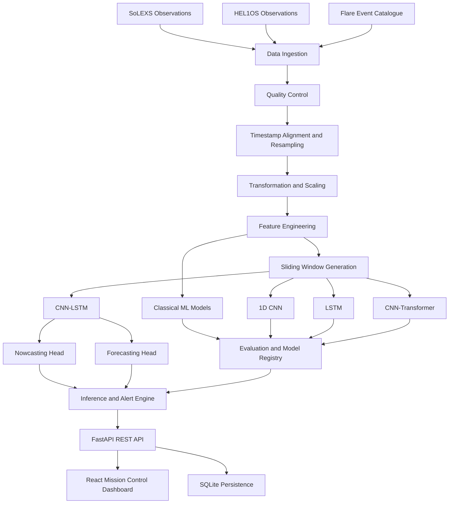

# Aditya-L1 Solar Flare Intelligence System

## Dual-Instrument X-Ray Early Warning and Prediction System

A full-stack research prototype for solar flare nowcasting and probabilistic forecasting using fused soft and hard X-ray observations from the Solar Low Energy X-ray Spectrometer (SoLEXS) and High Energy L1 Orbiting X-ray Spectrometer (HEL1OS) aboard India's Aditya-L1 solar observatory.

The system integrates data ingestion, preprocessing, feature engineering, machine learning, deep learning, multi-instrument fusion, alert management, and interactive visualization through a mission control dashboard.

## Technology Stack

- **Programming Language:** Python 3.11+
- **Backend:** FastAPI
- **Frontend:** React 18, Vite, Tailwind CSS
- **Machine Learning:** Scikit-learn, XGBoost
- **Deep Learning:** TensorFlow, Keras, or PyTorch, depending on the selected implementation
- **Data Processing:** NumPy, Pandas, SciPy
- **Data Formats:** CSV, FITS
- **Database:** SQLite
- **Deployment:** Docker, Docker Compose
- **Testing:** Pytest

## 1. Scientific Problem and Motivation

Solar flares are sudden releases of magnetic energy in the solar atmosphere, primarily associated with magnetic reconnection. Significant solar flare events can affect space-based and terrestrial technological infrastructure, including:

- High-frequency radio communications
- Global Navigation Satellite Systems (GNSS)
- Satellite electronics and communications
- Earth's upper atmosphere and satellite orbital drag
- Electrical power and communication infrastructure through associated space-weather effects

Timely identification of developing solar flares is important for space-weather monitoring and risk assessment.

### 1.1 SoLEXS: Soft X-Ray Observations

SoLEXS observes solar X-ray emissions in the approximate energy range of 1–30 keV.

Soft X-ray measurements provide information about the thermal plasma response during solar flare development, including the rise, peak, and decay phases.

### 1.2 HEL1OS: Hard X-Ray Observations

HEL1OS observes hard X-ray emissions over an approximate energy range of 10–150 keV.

Hard X-ray observations help characterize energetic electron populations and impulsive energy-release processes associated with solar flares.

### 1.3 Multi-Instrument Data Fusion

The system combines observations from both instruments to investigate whether their complementary temporal and spectral information improves flare detection and forecasting.

A domain-specific feature is the hard-to-soft intensity ratio:

\[
R(t)=\frac{F_{\mathrm{hard}}(t)}
{F_{\mathrm{soft}}(t)+\epsilon}
\]

where:

- \(F_{\mathrm{hard}}(t)\) represents the calibrated HEL1OS intensity.
- \(F_{\mathrm{soft}}(t)\) represents the calibrated SoLEXS intensity.
- \(\epsilon\) is a small positive constant that prevents division by zero.

A rise in this ratio may indicate an increase in hard X-ray emission relative to soft X-ray emission. Its forecasting value must be established empirically using properly aligned observations and independent evaluation data.

The Neupert effect provides a physical motivation for examining the temporal relationship between hard and soft X-ray emissions. However, the timing relationship varies between events and should not be treated as a universal fixed lead time.

## 2. Prediction Objectives

The system supports two complementary prediction tasks.

### 2.1 Solar Flare Nowcasting

Nowcasting estimates the current solar activity state using recent X-ray observations and engineered temporal features.

The proposed four-class classification scheme is:

| Class | Description |
|---|---|
| Quiet | Background solar activity without a detected flare |
| Pre-Flare | Observed signatures potentially associated with developing flare activity |
| Flare In Progress | Active flare phase |
| Decay Phase | Declining emission following the flare peak |

The classes require consistent operational definitions and reliable event annotations before model training.

### 2.2 Probabilistic Forecasting

The forecasting component estimates the probability of an M1.0-or-higher solar flare onset within the following time horizons:

- Within 1 hour
- Within 3 hours
- Within 6 hours
- Within 12 hours
- Within 24 hours

Each horizon produces a binary probabilistic prediction.

For a horizon \(h\), the target can be defined as:

\[
y_h(t)=
\begin{cases}
1, & \text{if an eligible flare begins within }(t,t+h] \\
0, & \text{otherwise}
\end{cases}
\]

Forecast targets must be constructed using event onset times, with appropriate handling of overlapping events and incomplete observations.

## 3. System Architecture

The application follows a modular architecture consisting of data ingestion, preprocessing, feature extraction, model training, inference, alert management, and visualization.



### 3.1 Data Ingestion

The ingestion layer accepts supported CSV and FITS observations from SoLEXS and HEL1OS, together with relevant solar flare event catalogues.

The ingestion process validates file structure, timestamps, measurement columns, and data availability.

### 3.2 Preprocessing

The preprocessing pipeline includes:

1. Data quality checks and invalid-value handling.
2. Identification of missing measurements and anomalous spikes.
3. Timestamp alignment between instruments.
4. Resampling to a common cadence, such as 60 seconds, where scientifically appropriate.
5. Logarithmic transformation of positive intensity measurements.
6. Feature scaling using parameters fitted exclusively on the training data.
7. Generation of synchronized sliding-window sequences.

Resampling and interpolation must preserve data gaps and avoid introducing artificial flare signatures.

### 3.3 Feature Engineering

The proposed feature set includes:

- Soft X-ray intensity
- Hard X-ray intensity
- Hard-to-soft intensity ratio
- Rolling mean and standard deviation
- First-order temporal derivatives
- Intensity growth rates and slopes
- Local maxima and minima
- Temporal variability measures
- Decomposition-based trend and residual features, where appropriate

All features must be computed using information available at or before the prediction timestamp to prevent temporal leakage.

### 3.4 Model Suite

The system supports the evaluation of multiple model families.

**Classical machine learning models**

- Logistic Regression
- Random Forest
- Support Vector Machine
- XGBoost

**Deep learning models**

- One-dimensional Convolutional Neural Network (1D-CNN)
- Long Short-Term Memory network (LSTM)
- CNN-LSTM hybrid
- CNN-Transformer hybrid

The CNN-LSTM model is a candidate primary architecture. It combines local temporal feature extraction with sequential modeling.

A shared representation can feed two prediction heads:

- A four-class softmax head for nowcasting.
- A multi-horizon sigmoid head for probabilistic forecasting.

The implementation should select the best model using validation performance rather than assuming that a particular architecture is superior in advance.

## 4. Multi-Task Learning Objective

The proposed multi-task model combines nowcasting and forecasting losses:

\[
\mathcal{L}_{\mathrm{total}} =
\alpha\mathcal{L}_{\mathrm{CE}}
+
\beta\sum_{h\in H}w_h\mathcal{L}_{\mathrm{BCE},h}
\]

where:

- \(\mathcal{L}_{\mathrm{CE}}\) is the categorical cross-entropy loss for nowcasting.
- \(\mathcal{L}_{\mathrm{BCE},h}\) is the binary cross-entropy loss for forecast horizon \(h\).
- \(H=\{1,3,6,12,24\}\) represents the forecast horizons in hours.
- \(w_h\) weights the contribution of each forecasting horizon.
- \(\alpha\) and \(\beta\) control the relative importance of the two tasks.

### 4.1 Class Imbalance

Major solar flares are relatively rare compared with quiet periods. Class imbalance can therefore make ordinary accuracy misleading.

Possible mitigation strategies include:

- Class-weighted cross-entropy.
- Positive-class weighting for binary cross-entropy.
- Threshold selection using validation data.
- Event-aware sampling where appropriate.

Any resampling strategy must preserve chronological separation between training, validation, and test data.

### 4.2 Temporal Data Splitting

The proposed evaluation strategy uses chronological partitions:

- Training: earliest 70% of the timeline.
- Validation: subsequent 15%.
- Testing: latest 15%.

Preprocessing parameters, feature-selection decisions, and model hyperparameters must be determined without using the held-out test period.

Sliding windows that cross partition boundaries require careful handling to prevent leakage. Where forecast labels span future intervals, boundary samples should be excluded or assigned according to a clearly documented policy.

## 5. Evaluation Metrics

Model performance is assessed using metrics suited to rare-event detection and probabilistic forecasting.

### 5.1 True Skill Statistic

\[
\mathrm{TSS}=
\frac{TP}{TP+FN}
-
\frac{FP}{FP+TN}
\]

TSS measures the difference between the probability of detection and the false-positive rate. A value of 1 represents perfect classification, while 0 indicates no discriminatory skill under this metric.

### 5.2 Heidke Skill Score

The Heidke Skill Score (HSS) evaluates categorical forecasts relative to expected performance from random forecasts with the same marginal frequencies.

### 5.3 Probability of Detection

\[
\mathrm{POD}=\frac{TP}{TP+FN}
\]

POD measures the proportion of observed positive events that the model correctly detects.

### 5.4 Precision

\[
\mathrm{Precision}=\frac{TP}{TP+FP}
\]

Precision measures the proportion of predicted positive events that are genuine positive events.

### 5.5 False Alarm Ratio

\[
\mathrm{FAR}=\frac{FP}{TP+FP}
\]

FAR measures the proportion of predicted positive events that are false alarms.

### 5.6 F1-Score

\[
F_1=2\cdot
\frac{\mathrm{Precision}\cdot\mathrm{Recall}}
{\mathrm{Precision}+\mathrm{Recall}}
\]

The F1-score balances precision and recall.

### 5.7 Brier Score

\[
\mathrm{BS}=\frac{1}{N}
\sum_{i=1}^{N}(p_i-y_i)^2
\]

The Brier Score measures the squared error of probabilistic predictions. Lower values indicate better probabilistic accuracy.

Evaluation should report event-level and sample-level performance where relevant, along with confidence intervals, forecast thresholds, and the number of positive events in each evaluation partition.

## 6. Multi-Instrument Fusion Experiment

An important research objective is to determine whether combining SoLEXS and HEL1OS observations improves predictive performance compared with using either instrument independently.

The proposed experiment evaluates three configurations:

1. SoLEXS-only input.
2. HEL1OS-only input.
3. Combined SoLEXS and HEL1OS input.

The configurations should use comparable chronological partitions, target definitions, training procedures, and evaluation metrics.

### Illustrative Demonstration Results

The following values are illustrative demonstration metrics and are not established scientific findings.

| Configuration | TSS | HSS | POD | Precision | F1-Score | FAR |
|---|---:|---:|---:|---:|---:|---:|
| SoLEXS Only | 0.621 | 0.548 | 0.692 | 0.635 | 0.662 | 0.171 |
| HEL1OS Only | 0.658 | 0.590 | 0.725 | 0.672 | 0.697 | 0.152 |
| SoLEXS + HEL1OS | 0.765 | 0.702 | 0.812 | 0.738 | 0.773 | 0.108 |

These values are intended to demonstrate how comparative results can be presented. If they were generated using synthetic data, they must not be interpreted as measured performance on real Aditya-L1 observations.

Scientific claims about fusion performance require reproducible experiments on appropriately annotated observational data.

## 7. Application Features

The mission control dashboard provides a unified interface for data analysis and model inference.

### 7.1 Dashboard

Displays summary statistics, recent observations, active model information, prediction results, and alert history.

### 7.2 Data Explorer

Supports uploading and inspecting CSV and FITS files, previewing observations, and reviewing data quality and sampling cadence.

### 7.3 Data Pipeline

Executes preprocessing, temporal alignment, feature engineering, and sequence generation.

### 7.4 Model Registry

Lists available models, their configurations, training status, and evaluation metrics. Supports selecting a model for inference.

### 7.5 Training and Evaluation

Provides workflows for training supported models and comparing their validation and test performance.

### 7.6 Live Monitor

Replays historical telemetry sequentially at configurable playback speeds to demonstrate streaming inference and alert generation.

### 7.7 Alert Management

Stores generated alerts, their timestamps, associated prediction results, and acknowledgement status.

Historical playback is a demonstration of the operational workflow; it does not constitute a live connection to Aditya-L1 telemetry.

## 8. REST API

The backend exposes REST endpoints through FastAPI.

| Method | Endpoint | Description |
|---|---|---|
| GET | `/api/health` | Returns service health information |
| GET | `/api/dashboard/summary` | Returns dashboard metrics and recent activity |
| GET | `/api/data/preview` | Previews available observations |
| POST | `/api/data/upload` | Uploads supported observation files |
| POST | `/api/preprocess` | Executes preprocessing and feature extraction |
| GET | `/api/features` | Returns engineered features and correlation information |
| GET | `/api/models` | Lists registered models and their evaluation results |
| POST | `/api/models/select` | Selects the active inference model |
| POST | `/api/models/train` | Initiates model training |
| POST | `/api/predict` | Generates nowcasting and multi-horizon forecast predictions |
| GET | `/api/experiments/fusion` | Retrieves or executes the instrument-fusion experiment |
| POST | `/api/simulation/start` | Starts historical telemetry playback |
| GET | `/api/alerts` | Retrieves active and historical alerts |
| PATCH | `/api/alerts/{id}/acknowledge` | Acknowledges a specified alert |

Interactive API documentation is available at `/docs` when the backend is running.

## 9. Operating Modes

### 9.1 Demonstration Mode

Demonstration mode uses synthetic observations to illustrate the end-to-end application workflow.

Depending on the configured implementation, it can initialize sample telemetry, demonstration alerts, and model registry entries.

The simulated stream can be replayed at configurable speeds, such as 1x, 5x, 10x, and 50x.

Synthetic observations and predictions are intended exclusively for demonstration and software verification.

### 9.2 Real Data Mode

Real data mode supports the ingestion and processing of compatible CSV and FITS observation files.

The preprocessing adapters transform the input data into the representation expected by the selected model.

Real-data forecasting requires verified instrument data, reliable event labels, suitable training and validation procedures, and independently evaluated models. Uploading real observations alone does not establish operational forecasting capability.

## 10. Installation and Setup

### Prerequisites

- Python 3.11 or later.
- Node.js 18 or later.
- npm.
- Git.
- Docker and Docker Compose, if using containerized deployment.

### 10.1 Run with Docker

From the project root directory:

```bash
docker compose up --build
```

After the services start, open:

- Frontend: `http://localhost:5173`
- Backend API: `http://localhost:8000`
- Interactive API documentation: `http://localhost:8000/docs`

The standard Docker configuration uses a same-origin `/api` route, typically handled by the configured reverse proxy.

### 10.2 Backend Setup

Open a terminal in the project root:

```bash
cd backend

python -m venv venv
```

Activate the virtual environment.

Linux or macOS:

```bash
source venv/bin/activate
```

Windows PowerShell:

```powershell
.\venv\Scripts\Activate.ps1
```

Install the dependencies:

```bash
python -m pip install -r requirements.txt
```

Run the tests:

```bash
python -m pytest tests/ -v
```

Start the development server:

```bash
python -m uvicorn app.main:app --reload --port 8000
```

### 10.3 Frontend Setup

Open a second terminal:

```bash
cd frontend
npm install
npm run dev
```

If the project contains a valid `package-lock.json` and uses reproducible dependency installation, `npm ci` can be used instead of `npm install`.

On Windows PowerShell, `npm.cmd` can be used if script execution restrictions prevent running `npm`.

The frontend development server is available at `http://localhost:5173`.

## 11. Demonstration Workflow

1. Start the backend and frontend services, or launch the application using Docker Compose.
2. Open the dashboard and inspect the available demonstration data.
3. Navigate to the Data Pipeline page and execute the preprocessing workflow.
4. Open the Models page and select an available model or train a supported model.
5. Inspect the model evaluation results and forecasting outputs.
6. Open the Live Monitor page and start sequential historical telemetry playback.
7. Review generated alerts and inspect their timestamps and prediction details.
8. Use the Data Explorer to upload and inspect compatible real observations.

The exact workflow depends on the available data, model artifacts, environment configuration, and implemented application features.

## 12. Testing and Verification

Run the backend test suite from the backend directory:

```bash
pytest tests -q
```

Testing should cover:

- Data ingestion and file validation.
- Timestamp alignment and resampling.
- Missing-value and anomaly handling.
- Feature engineering.
- Temporal data-split integrity.
- Model training and inference.
- Forecast probability generation.
- API request and response validation.
- Alert persistence and acknowledgement.
- Historical playback behavior.

Tests using synthetic data should be distinguished from validation experiments using real observational data.

## 13. Project Structure

The following is a representative project structure. Actual filenames and directories may vary by implementation.

```text
aditya-l1-solar-flare-intelligence/
├── backend/
│   ├── app/
│   │   ├── main.py
│   │   ├── api/
│   │   ├── services/
│   │   └── database/
│   ├── ml/
│   │   ├── preprocessing/
│   │   ├── features/
│   │   ├── models/
│   │   └── evaluation/
│   ├── tests/
│   └── requirements.txt
├── frontend/
│   ├── src/
│   ├── public/
│   ├── package.json
│   └── vite.config.js
├── docker-compose.yml
├── Dockerfile
├── README.md
└── LICENSE
```

## 14. Research Scope and Limitations

This project is a research and educational prototype designed to investigate multi-instrument solar flare prediction.

Its scientific validity depends on several factors:

- The quality and calibration of the input observations.
- Reliable synchronization of the two instruments.
- The accuracy and temporal resolution of flare event labels.
- Prevention of temporal and preprocessing leakage.
- Appropriate treatment of missing observations and instrument-specific limitations.
- Independent evaluation across different time periods and solar activity conditions.
- Calibration and uncertainty assessment of probabilistic predictions.
- Reproducibility of training, evaluation, and model selection.

The proposed fusion architecture and feature set are research hypotheses that require empirical validation. Demonstration metrics and synthetic model outputs must not be presented as operationally verified performance.

## 15. Scientific Disclaimer

This application is an educational and research prototype. It is not an official ISRO operational forecasting system and is not endorsed by ISRO.

Synthetic data, demonstration alerts, and unvalidated model predictions must not be used for operational space-weather decisions. Predictions generated from real observations also require independent scientific validation before they can support safety-critical or operational use.

## License

This project is distributed under the MIT License, subject to the terms specified in the repository's `LICENSE` file.
