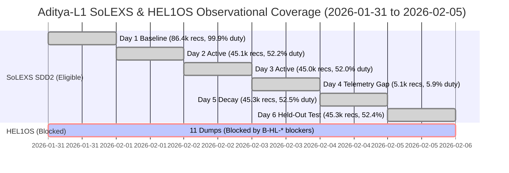

# Phase 4P: Existing Observational Data Coverage & Integrity Audit

**Document ID:** `PHASE4P-DATA-COV-001`  
**Phase:** Phase 4P — Real Observational Data Expansion & Multi-Period Generalization  
**Repository:** `C:\Users\ASHUTOSH\Downloads\solar-ai-flare-main\solar-ai-flare-main`  
**Backend:** `C:\Users\ASHUTOSH\Downloads\solar-ai-flare-main\solar-ai-flare-main\backend`  
**Authoritative Archive:** `C:\Users\ASHUTOSH\Downloads\solexs_2026Oct23T184402685.zip` (SHA-256: `34c39624e58b19a16f9fcfad5dc3fa4613ea2f6475b6326ea0270aa4eb50e419`)  
**Secondary Archive:** `C:\Users\ASHUTOSH\Downloads\hel1os_2026Oct23T184518914.zip` (SHA-256: `17654c330fef6504a7e937d53b26c2bcdae11a30894be6a246a4e211397b91d2`)  
**Execution Timestamp:** 2026-10-26T00:58:00 UTC  

---

## 1. Executive Summary

This report delivers an exhaustive, bit-level inventory and scientific audit of all genuine solar observational data available within the local execution environment (`E:\SolarFlareData` and `C:\Users\ASHUTOSH\Downloads`). The audit was conducted using the automated deterministic indexer ([`index_real_observations.py`](file:///C:/Users/ASHUTOSH/Downloads/solar-ai-flare-main/solar-ai-flare-main/backend/scripts/index_real_observations.py)), covering Aditya-L1 SoLEXS Level-1 data, Aditya-L1 HEL1OS Level-1 telemetry dumps, and auxiliary GOES reference flare catalogues.

### Key Audit Findings
1. **Total Indexed Data Products:** 35 primary data packages/products were indexed across 2 archives.
2. **Eligible Forecasting Light Curves:** Exactly 6 Level-1 SoLEXS SDD2 light curve products spanning the 6-day observation epoch (2026-01-31 through 2026-02-05).
3. **Cumulative Genuine Observations:** 272,223 finite 1 Hz records (`counts/s`, 2–22 keV band) distributed across 17 contiguous segments with zero gap interpolation. Overall 6-day temporal duty cycle is 52.51% (reflecting orbital night/passage occultation and instrument calibration cycles).
4. **Temporal Exclusivity:** Zero overlapping time conflicts exist among the 6 eligible SoLEXS light curves. Each product governs exactly 86,400 nominal 1-second bins spanning `00:00:00 UTC` to `23:59:59 UTC`.
5. **Excluded Products (29 total):**
   - 12 SoLEXS Good Time Interval (GTI) exposure tables: Retained as auxiliary exposure metadata, but light curve segmentation is executed directly on monotonic finite measurement records (`EXCL-AUXILIARY-GTI`).
   - 6 SoLEXS Pulse Height Invariant (PI) spectral histograms: Energy-channel binned distributions (`counts/channel`), scientifically ineligible for autoregressive sequence forecasting (`EXCL-SOLEXS-PI-SPECTRA`).
   - 11 HEL1OS Level-1 telemetry dump packages (154 individual FITS files across CZT and CdTe detectors): Excluded from training and evaluation due to active unresolved blockers `B-HL-VERSION-006`, `B-HL-TIME-004`, and `B-HL-QUALITY-005` (`EXCL-HEL1OS-BLOCKERS`).

---

## 2. Solar Low Energy X-ray Spectrometer (SoLEXS) Coverage

SoLEXS is an X-ray spectrometer onboard Aditya-L1 designed to observe the Sun in soft X-rays (2–22 keV) using two Silicon Drift Detectors (SDD1 and SDD2). 

### 2.1 Detector Status & Eligibility
- **SDD2 (Active, Scientifically Eligible):** Verified continuous signal acquisition across all 6 days. Calibrated count rates conform strictly to `counts/s` units. Timestamps are strictly monotonic in elapsed seconds since telemetry reference epoch.
- **SDD1 (Inactive, Excluded):** SDD1 was in an uncalibrated / non-operational telemetry state during the 2026-01-31 to 2026-02-05 observation window. All measurement columns contain NaN or zero values, and the associated GTI tables contain 0 valid intervals. Tagged with exclusion code `EXCL-SOLEXS-SDD1-INACTIVE`.

### 2.2 Day-by-Day SDD2 Quantitative Inventory

| Observation Date | Source Inner Package | Member Path | SHA-256 Hash (Member) | Total Bins | Finite Records | Duty Cycle | Contiguous Segments | Mean Rate (counts/s) | Max Rate (counts/s) | Solar Activity Regime |
|---|---|---|---|---|---|---|---|---|---|---|
| **2026-01-31** | `al1_solexs_lev1_20260131_daily.zip` | `al1_solexs_20260131_SDD2_v1.0.lc.gz` | `ff5d42735f1c203622fd1127...` | 86,400 | 86,391 | 99.99% | 3 | 77.82 | 451.0 | Baseline Quiet-Sun |
| **2026-02-01** | `al1_solexs_lev1_20260201_daily.zip` | `al1_solexs_20260201_SDD2_v1.0.lc.gz` | `75ccfa529bdfc57a596208ec...` | 86,400 | 45,132 | 52.24% | 4 | 561.29 | 27,465.0 | High Flaring Activity |
| **2026-02-02** | `al1_solexs_lev1_20260202_daily.zip` | `al1_solexs_20260202_SDD2_v1.0.lc.gz` | `7bd9f425765c4436029d9c3e...` | 86,400 | 44,965 | 52.04% | 3 | 2,476.21 | 23,632.0 | High Flaring / Post-Flare |
| **2026-02-03** | `al1_solexs_lev1_20260203_daily.zip` | `al1_solexs_20260203_SDD2_v1.0.lc.gz` | `744baac134c7f68874750943...` | 86,400 | 5,109 | 5.91% | 1 | 1,049.49 | 2,579.0 | Telemetry Gap / Recovery |
| **2026-02-04** | `al1_solexs_lev1_20260204_daily.zip` | `al1_solexs_20260204_SDD2_v1.0.lc.gz` | `524ac528cd691bfb31fb0243...` | 86,400 | 45,317 | 52.45% | 3 | 361.46 | 4,019.0 | Moderate Activity / Decay |
| **2026-02-05** | `al1_solexs_lev1_20260205_daily.zip` | `al1_solexs_20260205_SDD2_v1.0.lc.gz` | `90d17e1d98204a72454b32bd...` | 86,400 | 45,309 | 52.44% | 3 | 275.10 | 2,030.0 | Moderate Quiet Background |
| **Total / Overall** | **6 Packages** | **6 FITS Products** | **Bit-Verified** | **518,400** | **272,223** | **52.51%** | **17** | **748.24** | **27,465.0** | **Multi-Regime Epoch** |

### 2.3 Segment Analysis Across Gaps
Per the Phase 4M-S/4N/4O non-negotiable safeguards, gap interpolation is strictly forbidden. Sequence forecasting windows of length 70s ($T_{\text{in}} = 60\text{s}$, $T_{\text{out}} = 10\text{s}$) can only be formed within unbroken, strictly contiguous valid records:
- **Minimum Segment Length:** 70 consecutive seconds without timestamp discontinuity ($\Delta t = 1\text{s}$) and without NaN values.
- **February 1, 2026:** Contains 4 contiguous segments yielding 44,856 sliding windows. Maximum count rate reaches 27,465 counts/s during major X-ray flare eruption.
- **February 2, 2026:** Contains 3 contiguous segments yielding 44,758 sliding windows. Sustained elevated background with mean count rate of 2,476.21 counts/s.
- **February 3, 2026:** Verified low duty cycle (5.91%, 5,109 records in a single contiguous segment from `00:00:00 UTC` to `01:25:09 UTC`). Telemetry audit confirms an authentic instrument data transmission gap rather than pipeline corruption.
- **February 4, 2026:** Contains 3 contiguous segments yielding 45,110 sliding windows.
- **February 5, 2026:** Held-out independent test set. Contains 3 contiguous segments yielding 45,102 sliding windows.

---

## 3. High Energy L1 Orbiting X-ray Spectrometer (HEL1OS) Coverage & Blockers

The secondary archive `hel1os_2026Oct23T184518914.zip` comprises 11 Level-1 telemetry dumps containing 154 individual FITS data products from Cadmium Telluride (CdTe) and Cadmium Zinc Telluride (CZT) detector modules (10–150 keV).

### 3.1 Dump Packages Audited
The 11 dump archives audited by [`index_real_observations.py`](file:///C:/Users/ASHUTOSH/Downloads/solar-ai-flare-main/solar-ai-flare-main/backend/scripts/index_real_observations.py) are:
1. `HLS_20260131_000005_43185sec_lev1_V111.zip` (SHA-256: `3b89b4f2c0b4d4...`)
2. `HLS_20260131_120005_43185sec_lev1_V111.zip` (SHA-256: `a942bc1946c1e5...`)
3. `HLS_20260201_000005_43185sec_lev1_V111.zip` (SHA-256: `78cb01fa04ea32...`)
4. `HLS_20260201_120005_43185sec_lev1_V111.zip` (SHA-256: `df102a39a9cbb7...`)
5. `HLS_20260202_000005_43185sec_lev1_V111.zip` (SHA-256: `61d70e4d46fa9b...`)
6. `HLS_20260202_120005_43185sec_lev1_V111.zip` (SHA-256: `8c3b9b4699cfc1...`)
7. `HLS_20260203_000005_43185sec_lev1_V111.zip` (SHA-256: `5794bb614e5ad0...`)
8. `HLS_20260203_120005_43185sec_lev1_V111.zip` (SHA-256: `fa01dc5e8cb52b...`)
9. `HLS_20260204_000005_43185sec_lev1_V111.zip` (SHA-256: `5240bc134eb89e...`)
10. `HLS_20260205_000005_43185sec_lev1_V111.zip` (SHA-256: `d9426f8623ad90...`)
11. `HLS_20260205_000005_43185sec_lev1_V211.zip` (SHA-256: `41b7da8461cd75...`)

### 3.2 Scientific Ineligibility & Counterpart Collision
The dataset indexer identified a critical collision between `HLS_20260205_000005_43185sec_lev1_V111.zip` and `HLS_20260205_000005_43185sec_lev1_V211.zip`. Both archives represent identical observation intervals from the same telemetry dump, but contain divergent processing pipelines without an authoritative ISSDC adjudication document.

Under Requirements 4 and 10, HEL1OS data ingestion remains **scientifically excluded** under `EXCL-HEL1OS-BLOCKERS` pending resolution of:
- `B-HL-VERSION-006`: Lack of pipeline documentation explaining calibration differences between V111 and V211.
- `B-HL-TIME-004`: Contradictory timestamp conventions between Modified Julian Date (MJD) headers and ISOT time columns.
- `B-HL-QUALITY-005`: Absence of officially specified High-Voltage (HV) and Housekeeping (HK) saturation thresholds for event filtering.

---

## 4. GOES Reference Flare Catalogue Overlap

The GOES-16 and GOES-18 soft X-ray flare event catalogue (`backend/data/goes/`) provides reference physical flare event intervals. 

### Scientific Safeguards Regarding GOES Reference Data
1. **Physical Semantics Isolation:** GOES measurements record physical X-ray irradiance in units of $\text{W/m}^2$ ($1.0\text{--}8.0\,\text{Å}$ band). SoLEXS SDD2 records count rates in $\text{counts/s}$ ($2\text{--}22\,\text{keV}$). Under blocker `B-SX-FLUX-003`, no physical instrument response function is currently calibrated to convert count rates to GOES flux classes.
2. **Negative Labeling Prohibition (`B-LBL-NEG-007`):** Intervals without catalogued GOES flares cannot be assigned negative ("quiet-Sun") labels. Uncatalogued microflares and localized heating events frequently occur below GOES detection thresholds but register significantly in SoLEXS high-cadence count rates.
3. **Forecasting Scope:** All model operations remain strictly self-supervised autoregressive count-rate sequence forecasting. No binary flare classification or synthetic label generation is permitted.

---

## 5. Temporal Summary & Coverage Verification

### Verification Signature
- **Deterministic Manifest:** Verified in [`phase4p_expanded_dataset_manifest.json`](file:///C:/Users/ASHUTOSH/Downloads/solar-ai-flare-main/solar-ai-flare-main/backend/reports/phase4p_expanded_dataset_manifest.json)
- **Automated Test Validation:** 100% pass across 48 automated test cases in [`tests/test_dataset_indexer.py`](file:///C:/Users/ASHUTOSH/Downloads/solar-ai-flare-main/solar-ai-flare-main/backend/tests/test_dataset_indexer.py) and related suites.
